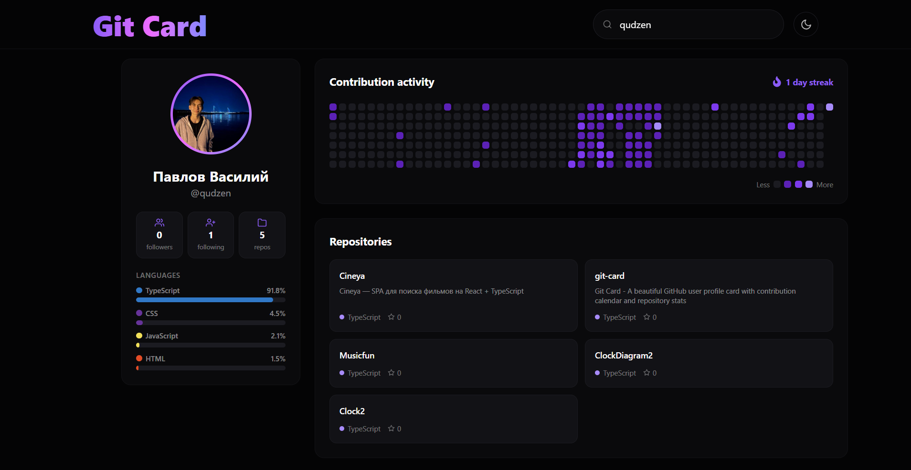

# Git Card

Профиль GitHub-пользователя в виде аккуратной карточки: аватар, статистика, языки, график коммитов и топ репозиториев.

## Стек

**Фронтенд**

**Бэкенд**

**Данные**

## О проекте

**Git Card** — веб-приложение, которое превращает профиль GitHub в компактную карточку. Введи логин — и получишь всё самое важное о пользователе в одном месте.

## Возможности

- **Живой поиск** с подсказками (debounce + отмена устаревших запросов)
- **Навигация с клавиатуры** по подсказкам — `↑` `↓`, `Enter`, `Esc`
- **Профиль** — аватар, имя, bio, статистика (followers / following / repos)
- **Языковая статистика** — топ-6 языков по объёму кода, с процентами и фирменными цветами
- **График коммитов** за год + подсчёт текущего стрика
- **Топ репозиториев** по звёздам — язык и звёзды
- **Тёмная / светлая тема** с сохранением выбора в `localStorage`

## API

Серверные функции находятся в каталоге `/api`:

| Эндпоинт | Описание |
| --- | --- |
| `GET /api/user` | Профиль пользователя |
| `GET /api/hints` | Подсказки для поиска |
| `GET /api/repos` | Топ репозиториев по звёздам |
| `GET /api/contributions` | Календарь коммитов (GraphQL) |
| `GET /api/languages` | Статистика языков (GraphQL) |

 
## Демо

Проект задеплоен на Vercel: [git-card-eta.vercel.app](https://git-card-eta.vercel.app)
